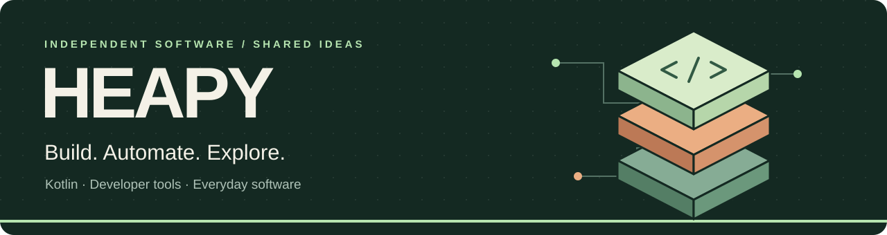

  

<h1 align="center">Kotlin at the core. Curiosity everywhere.</h1>

  Tools for working with coding agents, libraries for building in Kotlin, 
  and software for the things you want to get done.

  <a href="#find-your-starting-point">Find your starting point</a> &nbsp;·&nbsp;
  <a href="https://github.com/Heapy/.github/blob/main/docs/projects.md">All projects</a> &nbsp;·&nbsp;
  <a href="https://kotlin.link">Explore Kotlin</a>

## Find your starting point

| You want to… | Start here |
| :--- | :--- |
| Keep coding agents running and pick up work from another device | [Kotgent](https://github.com/Heapy/kotgent#readme) |
| Give your coding agent Kotlin knowledge and repeatable workflows | [Kortex](https://github.com/Heapy/kortex#readme) |
| Add plugins and CI to a Kotlin Toolchain project | [Kotlin Toolchain ecosystem](#build-check-and-ship-with-kotlin-toolchain) |
| Find a Kotlin library, tool, or learning resource | [Awesome Kotlin](https://kotlin.link) |
| Explore apps for reading, learning, and personal workflows | [Everyday software](https://github.com/Heapy/.github/blob/main/docs/projects.md#everyday-software) |

## Meet the projects

<table>
<tr>
<td width="50%" valign="top">
<h3><a href="https://github.com/Heapy/kotgent">Kotgent</a></h3>

<strong>Your coding sessions, wherever you are.</strong>

Run Claude, Codex, and Junie in persistent terminal sessions. Follow progress, manage a task backlog, and respond from a desktop, tablet, or phone.

<a href="https://github.com/Heapy/kotgent#readme">Start a session →</a>

</td>
<td width="50%" valign="top">
<h3><a href="https://github.com/Heapy/kortex">Kortex</a></h3>

<strong>Kotlin expertise for your coding agent.</strong>

Skills and plugins for Kotlin, Ktor, scripting, code review, and agent workflows. Packaged for Junie, Codex, and Claude Code.

<a href="https://github.com/Heapy/kortex#readme">Find your plugin →</a>

</td>
</tr>
<tr>
<td width="50%" valign="top">
<h3><a href="https://github.com/Heapy/kinetica">Kinetica</a></h3>

<strong>What if your UI were just a value?</strong>

A Kotlin UI framework built around immutable node trees, with headless testing, HTML server rendering, and a browser renderer. Native macOS support is also in development.

<a href="https://github.com/Heapy/kinetica#readme">Explore the framework →</a>

</td>
<td width="50%" valign="top">
<h3><a href="https://github.com/Heapy/awesome-kotlin">Awesome Kotlin</a></h3>

<strong>Find your next Kotlin building block.</strong>

A curated collection of Kotlin libraries, tools, and resources, with articles and updates available through kotlin.link and RSS.

<a href="https://kotlin.link">Browse the collection →</a>

</td>
</tr>
<tr>
<td width="50%" valign="top">
<h3><a href="https://github.com/Heapy/kotbusta">Kotbusta</a></h3>

<strong>Put your book collection to work.</strong>

Browse and search a personal INPX/FB2 library, convert books to EPUB, and send them to Kindle. Optional semantic search helps you discover related reads.

<a href="https://github.com/Heapy/kotbusta#readme">Explore your library →</a>

</td>
<td width="50%" valign="top">
<h3><a href="https://github.com/Heapy/kotomka">Kotomka</a></h3>

<strong>This could have been an article.</strong>

Turn technical videos into something you can read: summaries, detailed notes, key frames, timestamps, transcripts, and PDF export.

<a href="https://github.com/Heapy/kotomka#readme">Turn a talk into notes →</a>

</td>
</tr>
</table>

## Build, check, and ship with Kotlin Toolchain

From a local build to a published library: a family of independent integrations for JetBrains Kotlin Toolchain.

| Step | Tools |
| :--- | :--- |
| **Set up CI** | [setup-ktc](https://github.com/Heapy/setup-ktc) installs and caches the toolchain; [setup-main-kts](https://github.com/Heapy/setup-main-kts) prepares Kotlin scripts. |
| **Extend your build** | [ktc-plugins](https://github.com/Heapy/ktc-plugins) installs source plugins for formatting, API checks, coverage, documentation, containers, SQLDelight, Quarkus, and benchmarks. |
| **Check and release** | [ktc-check](https://github.com/Heapy/ktc-check) reports build and test results; [ktc-publish](https://github.com/Heapy/ktc-publish) prepares bundles and publishes libraries. |
| **Keep moving** | [update-ktc](https://github.com/Heapy/update-ktc) opens wrapper upgrade PRs; [ktc-to-gradle](https://github.com/Heapy/ktc-to-gradle) provides a path to a Gradle build when you need one. |

[Browse every plugin and integration →](https://github.com/Heapy/.github/blob/main/docs/projects.md#kotlin-toolchain-and-build-tools)

## More to explore

- **Libraries:** [krogu-time](https://github.com/Heapy/krogu-time) brings the Java `java.time` API to Kotlin Multiplatform; [kotaml](https://github.com/Heapy/kotaml) adds YAML serialization as a supported fork of kaml; [kotbot](https://github.com/Heapy/kotbot) helps build Telegram bots.
- **Your machine and services:** [Harmon](https://github.com/Heapy/harmon) explains macOS workload and resource pressure; [Kodkod](https://github.com/Heapy/kodkod) restarts unhealthy Docker containers and updates selected services.
- **New directions:** [kwasm](https://github.com/Heapy/kwasm) explores suspendable WebAssembly execution; [Keemun](https://github.com/Heapy/keemun) records architecture decisions as a graph. Both are experimental.
- **Personal workflows:** [Komok](https://github.com/Heapy/komok) is building toward a local-first place for information, tasks, and collaboration.

**[See the full project directory →](https://github.com/Heapy/.github/blob/main/docs/projects.md)** — including MCP servers, terminal tools, home integrations, experiments, and earlier work.

## Build with us

Try a project, tell us where it falls short, or help make it better. Each repository is the starting point for setup instructions, issues, and pull requests.

For Kotlin resources, contribute to [Awesome Kotlin](https://github.com/Heapy/awesome-kotlin). For a correction or a missing project on this page, [open an issue here](https://github.com/Heapy/.github/issues).
